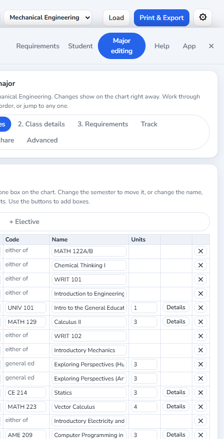

# Editing a major: a short walkthrough

For students and advisors who want to fix or build the rules of one major in JGDegreePlanner.
Unofficial planning aid. Nothing you type leaves your computer.

**Where:** click the **gear** (top right), then the **Major editing** tab.

## What you are editing

A **major** is a set of boxes (classes) laid out by semester, plus a list of **requirements** (what has to be finished). The tab works on whichever major is on the chart right now. Pick a major at the top first, or load a four-year plan PDF.

Changes show on the chart **right away**. They last until you close the page. Press **Save my changes** (step "Save & share") to keep a copy in this browser.

The tab has one step per button, so you only see one thing at a time:

| Step | What it is for |
|---|---|
| **1. Classes** | The boxes on the chart. Move, rename, add or remove them. |
| **2. Class details** | For one class: what comes first, when it is offered, a special requirement. |
| **3. Requirements** | What has to be finished for the degree, and how many units. |
| **Track** | One version of a major (for example Electrical or Computer). |
| **Save & share** | Keep your edits, or download a file. |
| **Advanced** | The technical settings (packs, approval, course catalog). Most people never need this. |

## Try these

### Add a class that is missing
1. **1. Classes**, press **+ Class**.
2. Type the **code** (ECE 220), the **name**, the **units** and pick the **semester**. Press **Add**.
3. The box appears on the chart. Use the **Semester** menu in its row to move it later.

### Add an elective box
1. **1. Classes**, press **+ Elective**.
2. Give it a name (Technical Elective) and a semester.
3. Optional: type the classes that are allowed, separated by commas. Leave it empty if any class may count. Press **Add**.

### Fix a prerequisite or when a class is offered
1. In the class row press **Details** (or go to **2. Class details** and pick the class).
2. **Take first**: type the classes, separated by commas. Use **or** for either-one, for example `ECE 101, MATH 129 or MATH 223`.
3. **Can be taken at the same time**: optional.
4. **Offered**: Fall only, Spring only, or any.
5. Tip: paste the course description from catalog.arizona.edu into the box and press **Read prerequisites from the text**. If the wording is unclear the app says so and does not guess.

### Say that a class needs a C or better
In **2. Class details**, use the **Special requirement for this class** box. **Needs a C or better** is one click. Type something else for any other rule.

### Add an extra requirement
1. **3. Requirements**, scroll to **Add a requirement**.
2. Type a name, the units needed, and the classes that count (comma between). Press **Add**.
3. It shows up in the Checks on the Requirements tab as Done, Planned or Missing.

### Tracks (versions of a major)
A **track** is one version of a major with its own boxes, for example the Electrical and Computer options of Electrical and Computer Engineering. Most majors have just one.
1. **Track** step. The table lists every track. **Show this track** puts it on the chart.
2. To change a name, type in the **Track name** box.
3. To add one: type a name under **Add a track**, then press **Add empty track** (starts blank) or **Add a copy of ...** (starts with the same boxes, handy for a variation).
4. **Delete track** removes one (it asks first). The last track cannot be deleted.

### Start a brand new major
With nothing loaded, the tab offers **Start empty** and **Start from my chart** (it turns the classes you already placed into required classes). Type the major name first.

### Keep and share your work
**Save & share**: **Save my changes** keeps a copy in this browser. **Download file** makes a pack file to send to an advisor or load on another computer (Load button).

## For advisors
Edits stay **UNVERIFIED** until approved. After you check every box, prerequisite and offering against the catalog, open **Advanced**, then **Advisor approval**, enter your approval code and press Approve. To get a code, email jgasteluminc@gmail.com with the subject "JGDegreePlanner advisor code request".

## Good to know
- Everything is optional and editable. Nothing is locked.
- **Remove** (the ✕) deletes the box. There is no undo, so Download a file first if you are unsure.
- The **Advanced** step still has every technical control, for people who want full control.
