# JGDegreePlanner

**A free degree planner in one file. Plan a degree on a flowchart, check prerequisites and when classes are offered, and print it.** Nothing to install, no account, and nothing you enter ever leaves your computer.

> **Unofficial.** JGDegreePlanner is an unofficial planning aid made by Juan Gastelum for students and advisors. It is not an official tool, and it is not made, endorsed or approved by any university. Always confirm your plan with your academic advisor and your advisement report.

<p align="center"></p>
<p align="center"><sub>The chart, shown with a made-up example student (Alex Doe).</sub></p>

## Get started in 1 minute

1. **Download** [`JGDegreePlanner.html`](https://github.com/TheJuanGastelum/JGDegreePlanner/releases/latest) (open the latest Release and download the file).
2. **Double-click it.** It opens in your browser (Chrome or Edge work best).
3. A short **guided tour** starts the first time. You can replay it any time from the gear, App tab.

Keep the file name exactly `JGDegreePlanner.html`. A copy with another name still works but shows a notice at the top (see the FAQ).

> Click any section below to open it. Every section is also in the app: **Tools**, then **Help**.

---

<details>
<summary><b>First 5 minutes</b></summary>

1. **Start here.** The app opens empty: faded stand-in boxes (Class A, Class B, made-up codes) show the layout. Load your advisement report (step 2) and the chart is built from it. Or pick a ready-made major at the top (University, College / School, Major, Track); Electrical & Computer Engineering is one.
2. **Load your plan:** the **Load** button (an advisement report PDF or a saved student file), or just drag the file onto the page. Need the report? UAccess, Advising, Advisement Report, View Report as PDF, Download (details below).
3. **Look at the chart.** Each column is a semester and each box is a class.
4. **Drag classes** to other semesters. Click a class to see its details and its prerequisite arrows.
5. Open the **gear**, then **Requirements** (the Checks are at the top), to see problems: a class before its prerequisite, a class in a semester it may not be offered, a heavy semester.
6. **Print & Export** (top right) to save a PDF or Excel file, or **Save my plan** (also in Print & Export) to keep your plan for next time.

**Your plan is not saved automatically.** Use **Print & Export, Save my plan** to download a student file, and Load file to open it again.

Want to look around first? Gear menu, **Load example plan (Alex Doe)** loads a made-up student.
</details>

<details>
<summary><b>Get your advisement report (University of Arizona)</b></summary>

1. Sign in to **UAccess** (Student Center).
2. Open the **Advising** menu, then **Advisement Report**.
3. Choose **View Report as PDF**, then **Download**.
4. In JGDegreePlanner: the **Load** button, and pick that PDF (or drag it onto the page).

**Major not built in?** Loading your report builds a temporary draft plan from it. You can also get the official requirements yourself: go to [catalog.arizona.edu/programs](https://catalog.arizona.edu/programs), find your major, open it, and download or print it as a PDF. Load that PDF the same way and a draft pack is built, with no student needed. Drafts show an UNVERIFIED banner until an advisor approves them.
</details>

<details>
<summary><b>Four-year plan PDFs (College of Engineering and others)</b></summary>

Colleges publish a four-year plan (an advised sequence of classes). The College of Engineering has one PDF per major and catalog year at [engineering.arizona.edu/current/4-year-degree](https://engineering.arizona.edu/current/4-year-degree).

1. Download your major's PDF and load it (the **Load** button). It must be the PDF: the app reads each column by its position on the page.
2. The app checks every semester against the printed "Semester Total". A semester that does not add up gets a warning with the numbers. Nothing is guessed.
3. You get a draft chart: semesters, units, UNIV 101 and 301, general education boxes, electives, Fall only / Spring only, and options as tracks.
4. Prerequisites are only the ones the plan prints. Click a class to type the rest, or press **Paste a course description** and paste the text from catalog.arizona.edu.
5. Load your advisement report. Your classes are placed into the chart (either order works).
6. Load the catalog printout of the same major (catalog.arizona.edu/programs, **Download as PDF**) to add the college, total units and class titles.

Ready-made drafts for Engineering and a few other majors are already built in. They stay marked **draft** until an advisor approves them.
</details>

<details>
<summary><b>For advisors</b></summary>

Checking one major once gives every student after that a trusted chart.

1. Pick the major, or load its four-year plan PDF.
2. Compare each box with the official catalog: class, units, semester, prerequisites, offering.
3. Fix boxes in **Major editing**, or click a class to edit its prerequisites.
4. In **Major editing, Advisor approval**, enter your approval code, tick the box and press **Approve**. The banner clears and printouts show your advisor ID and the date.
5. Save the pack and share the pack file.

To get a code, email jgasteluminc@gmail.com with the subject "JGDegreePlanner advisor code request" and be ready to show your role. Nothing is sent from the app and nothing is stored about students.
</details>

<details>
<summary><b>Loading files</b></summary>

Use the the **Load** button, or drag files onto the page (several at once is fine). The app works out what each file is:

| File | What happens |
|---|---|
| Advisement report (PDF or text) | Fills in your classes, grades, semesters and the Requirements page. If it does not fit the loaded major, a temporary draft plan is built from it. The reader is built for the University of Arizona report layout; reports from other schools may not read. |
| Saved student file (`.json`) or Excel file (`.xlsx`) saved by this app | Restores a whole plan, including the major it was made in. The Excel file carries the major itself when it is not built in. |
| Pack file (`.json`) | Adds a major. You can also drop a whole folder of packs. |
| Course catalog (`.csv` or `.json`) | Adds or updates course facts for a school. |
| catalog.arizona.edu program printout (PDF) | Makes a draft pack, with no student needed. |

If a PDF will not read, paste its text into **Student, Load courses**.
</details>

<details>
<summary><b>Saving your plan: JSON file or Excel file</b></summary>

Open **Print & Export** and use **Save my plan**:

| | **Save student file (JSON)** | **Save as Excel (.xlsx)** |
|---|---|---|
| What you get | A plain-text file for the app | A two-sheet workbook |
| Sheet 1 "Plan" | n/a | Your plan redrawn in the **standard layout**: semester columns, a colored left edge and an underline style per real semester, status marks, credits, prerequisites and the notes. Prints on one landscape page. |
| Sheet 2 "Data" | n/a | Everything the app needs to load it back, plus a readable class list. **Do not edit or delete it.** |
| Best for | Your own backups. It is exact and tiny. | Sharing with an advisor, or reading without the app. |
| Load it again | **Load file** | **Load file** (the same button) |

**Does loading the Excel file rebuild everything?** Yes: your student details, classes, semesters, grades, transfer credit, statuses, added classes and the loaded report numbers. If the major is not one the other person already has built in (a custom or imported pack), the Excel file carries the major too and installs it. Edits to your own course catalog are not included. Keep the Data sheet intact; if you edit the Plan sheet, those edits are not read back.
</details>

<details>
<summary><b>Reading the chart</b></summary>

<p align="center">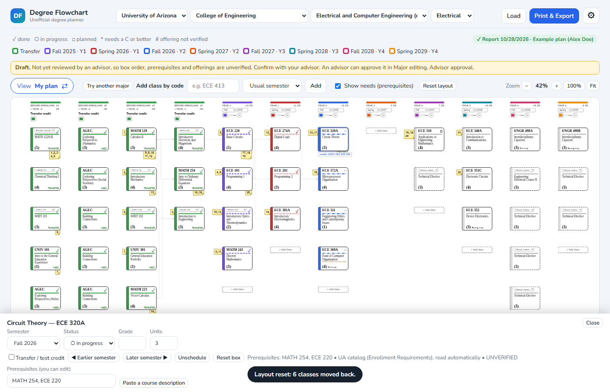</p>

- **Columns are semesters.** The first columns, "Transfer Yr", hold credit you had before enrolling (transfer, test, AGEC). A *Gap* semester is locked: no classes.
- **A box** shows the class code (or the choice or elective), its title, and the credits in brackets, like `(3)`.
- **Spine and underline:** the colored spine and the patterned line under the code show the semester. Every semester has its own color **and** its own pattern (dashes, dots and so on), so the chart still reads in black and white.
- **Status mark** at the top right: a check = done, a circle = in progress, a square = planned.
- `*` after a code means a **C or better** is required.
- **"Fall only" / "Spring only"** appears when a class is limited to one term. A `#` after it means that offering has not been verified.
- **AGEC / TRANSFER** next to the credits marks finished credit that came in that way.
- **Dashed border** = an elective box. Click its menu to choose which course fills it.
- **View button** (far left above the chart): it shows the current view and switches when clicked. **Standard layout** (the default) is the premade chart, every class in its official semester. It switches to My plan by itself when you start moving a class. **My plan** is your own chart with your real semesters and transfer credit up front, and is where you move classes. It works for any major.

<p align="center">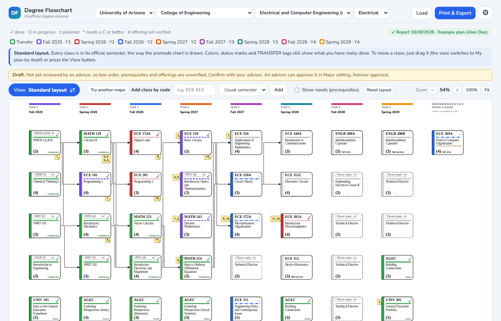</p>
</details>

<details>
<summary><b>Moving classes (dragging), Reset layout and Start over</b></summary>

<p align="center">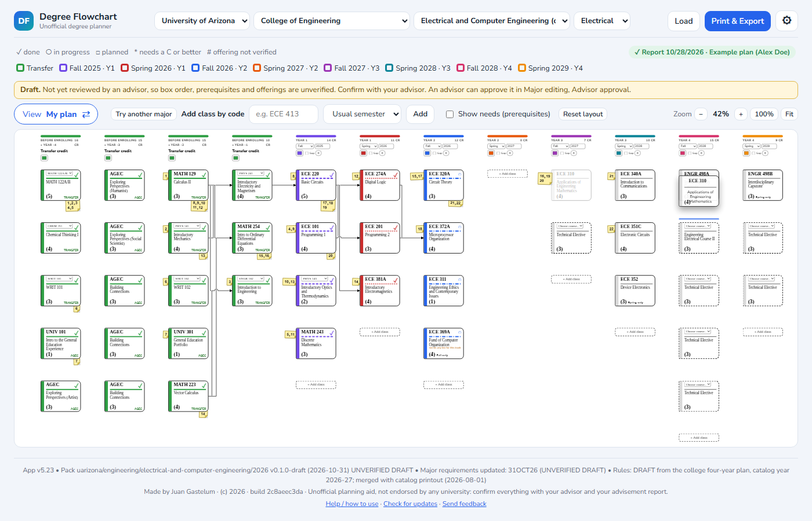</p>

- **Drag:** just press on a box, hold and drag. If you are in Standard layout the view switches to **My plan** by itself as soon as you start dragging. Press on a box, hold, and drag it to another semester. A ghost copy follows the mouse and a line shows where it will land. Let go to drop it. Near the edge of the chart it scrolls for you.
- **Not scheduled:** drop a box in the "Not scheduled" column on the right to take it off your plan, and drag it back when you want it.
- **Touch screens:** dragging is off. Tap a box, then use the **Earlier semester / Later semester** buttons in the bar at the bottom.
- **Click a box** (without dragging) to open the bar at the bottom: change the semester, status, grade and units, mark it as transfer or test credit, unschedule it or reset the box.
- **Column headers** let you rename a semester, change its color, mark it as a Gap, or remove it.

**Reset layout** (button above the chart): puts the classes you moved back in their standard semesters. You are asked to confirm. Finished and in-progress classes keep their real semesters; grades and statuses are not touched.

<p align="center">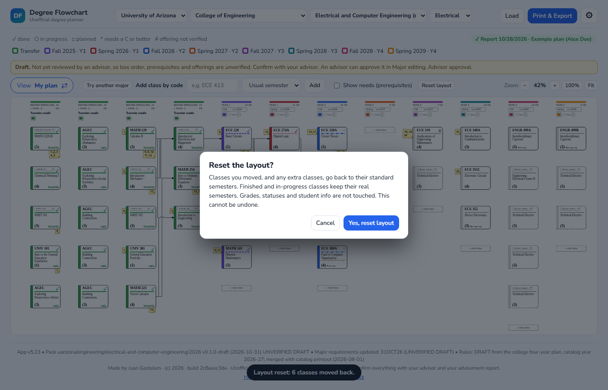</p>

**Start over** (gear, App tab): clears the whole plan and asks to confirm. You can save a copy first. There is no undo, so save your student file before big changes.
</details>

<details>
<summary><b>Arrows and sticky notes</b></summary>

<p align="center">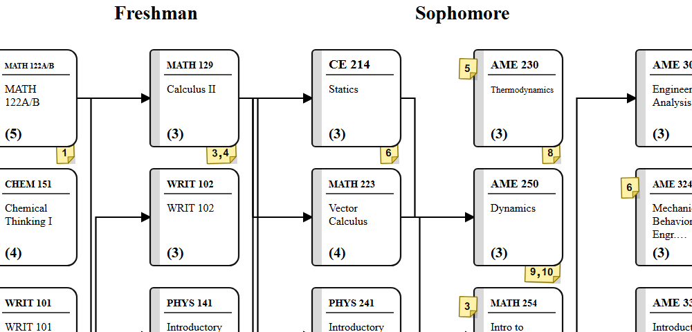</p>

Prerequisites are shown two ways:

- **Arrow lines** join a class to a prerequisite in the very next column. Each color is the semester the arrow leads into.
- **Sticky notes** replace long wires. A prerequisite more than one column away gets a number, and that number appears on **two** sticky notes:
  - one at the **lower right of the prerequisite** box (it is needed by a later class), and
  - one at the **upper left of the class that needs it**.

  Find the same number on both. Several numbers can share one note, like `10, 11`.
- A box with no arrows or notes has no prerequisites on this chart, or nothing here needs it.

**Click a class** and its arrows light up while the others fade. Turn on **Show needs** (above the chart) to list its prerequisites under it. A **red dashed arrow** means a class sits before its own prerequisite.
</details>

<details>
<summary><b>Add a class by code</b></summary>

Type a code such as `ECE 413` in the box above the chart, pick a semester (or leave it on *Usual semester*) and press **Add**.

1. If the class has its own box, it goes there.
2. Otherwise it goes in the first empty elective box it qualifies for.
3. Otherwise it goes in **Not scheduled** with a note: either "eligible: ..., needs a spot" or "not on any list for this track".

The same rule runs when you load a report. A class from a report keeps the semester it was taken in.
</details>

<details>
<summary><b>Top buttons, Print & Export, and the gear panel</b></summary>

Three buttons sit at the top right:

- **Load** opens your file picker: an advisement report PDF, a college four-year plan PDF, a saved student file or an Excel file. You can also drag a file onto the page.
- **Print & Export** opens the print panel. It shows the *Preview* first, then a list of every file type with what it is for (PDF, PNG, SVG, Excel, student file, major pack), then the print options (layout, color, the "needs" line, PDF paper size).
- **The gear** opens the settings panel on the tab you used last. A dot on the gear means there are problems to look at.

| Gear tab | What it is for |
|---|---|
| **Requirements** | The **Checks** at the top (Done, Planned or Missing for each requirement, and problems to fix), then GPA, units and major requirements. Only finished classes count as done. |
| **Student** | Name, student ID, catalog year, current semester, first semester (Year 1), **Auto-detect AGEC** (on by default; turn it off to choose yourself), manual paste of report text, and transfer credit. |
| **Major editing** | (Step-by-step guide: [MAJOR-EDITING.md](MAJOR-EDITING.md).) A plain editor for one major, one step at a time (Classes, Class details, Requirements, Track, Save & share, Advanced). Add or move required classes, add elective boxes, edit prerequisites (type them or paste the catalog description), and add extra requirements. **Keep my edits** saves a copy in this browser, **Save major pack file** exports it. Technical settings (packs folder, advisor approval, course catalog, draft builder) are under **Advanced** at the bottom. |
| **Help** | The guide, FAQ and contact links inside the app. |
| **App** | Load a file, the example plan, the guided tour, start over, and the theme. |

**Every section in the side panels folds up** when you click its title. Sections start folded, except the Checks, the Preview, the file list and the first Major editing section.

<p align="center">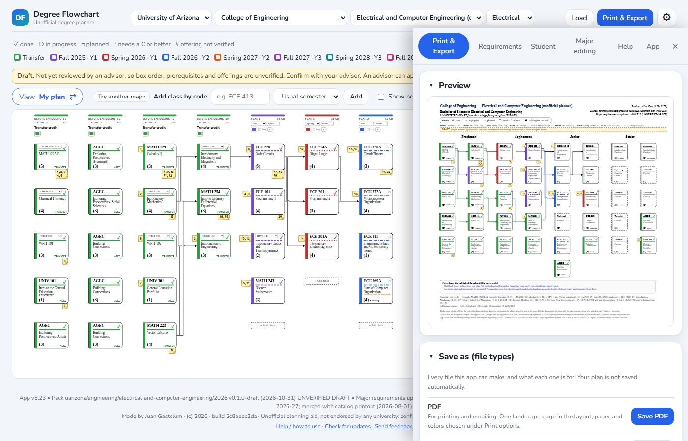 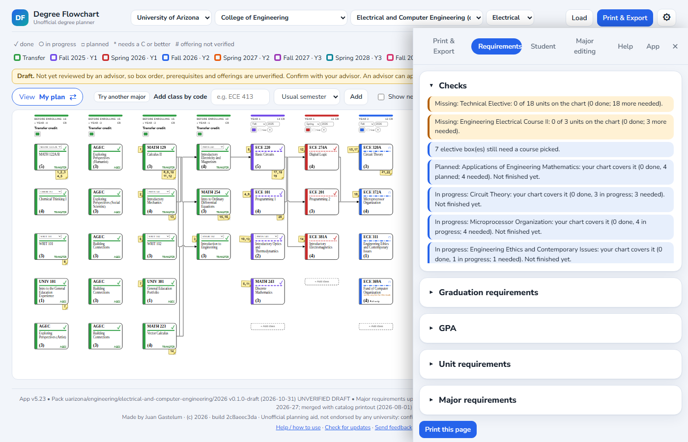</p>
</details>

<details>
<summary><b>Majors, drafts and approvals</b></summary>

<p align="center">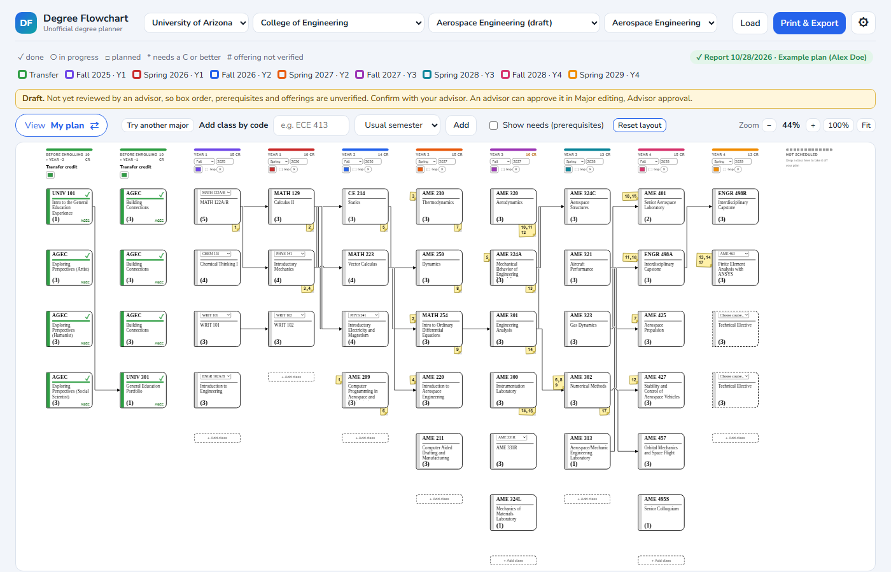</p>

- The app starts **blank** on "Choose a degree". **Electrical & Computer Engineering** is built in and was checked against the ECSE courses page.
- **Ready-made drafts** (Nursing, Public Health, more over time) are in the major list marked "draft". They were made from public catalog pages and have **not been reviewed by an advisor**. Use them to get started and confirm everything.
- **Make your own draft:** load your advisement report or a catalog program printout, review it in **Major editing, Advanced, Build a draft pack**, then **Save pack**.
- **Packs:** import and export packs in Rules. Imported packs stay in this browser, so export the ones you want to keep, or connect a **packs folder** (Chrome or Edge) and they load and save there automatically.
- **Advisor approval:** an advisor can approve a pack with a code the author issued (request one with the Contact links below). The app then shows the advisor's ID code (never a name) and the date, and printouts say "Major requirements updated: DDMMMYY (ID)". This is a check the author runs on who reviewed the pack. It is **not** an official approval by any university. Before an approval, printouts say "not advisor reviewed". If a pack is edited after approval, the approval stops counting.
- **Try another major (what-if):** the **Try another major** button above the chart copies your classes into another loaded major to try it, and keeps your real plan. Printouts are marked WHAT-IF. Use Back to return.

<p align="center">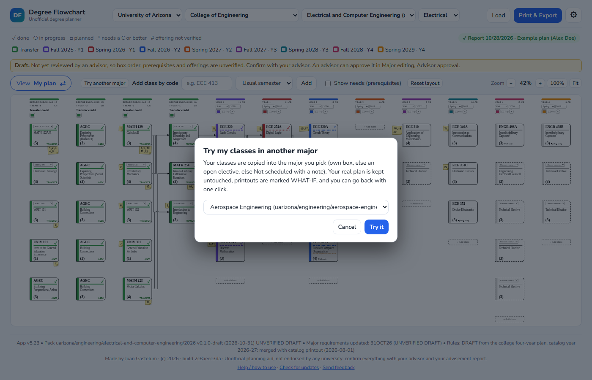</p>
</details>

<details>
<summary><b>Print & Export</b></summary>

<p align="center">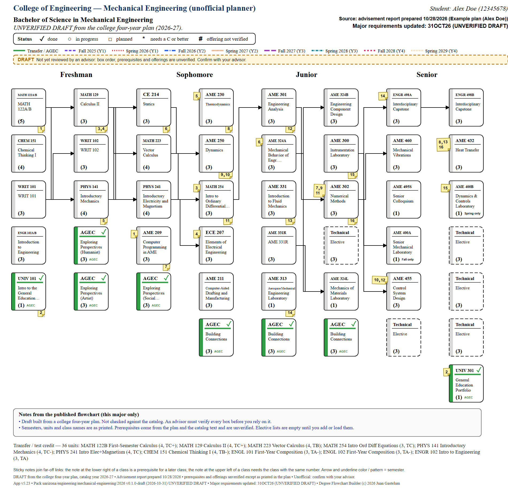 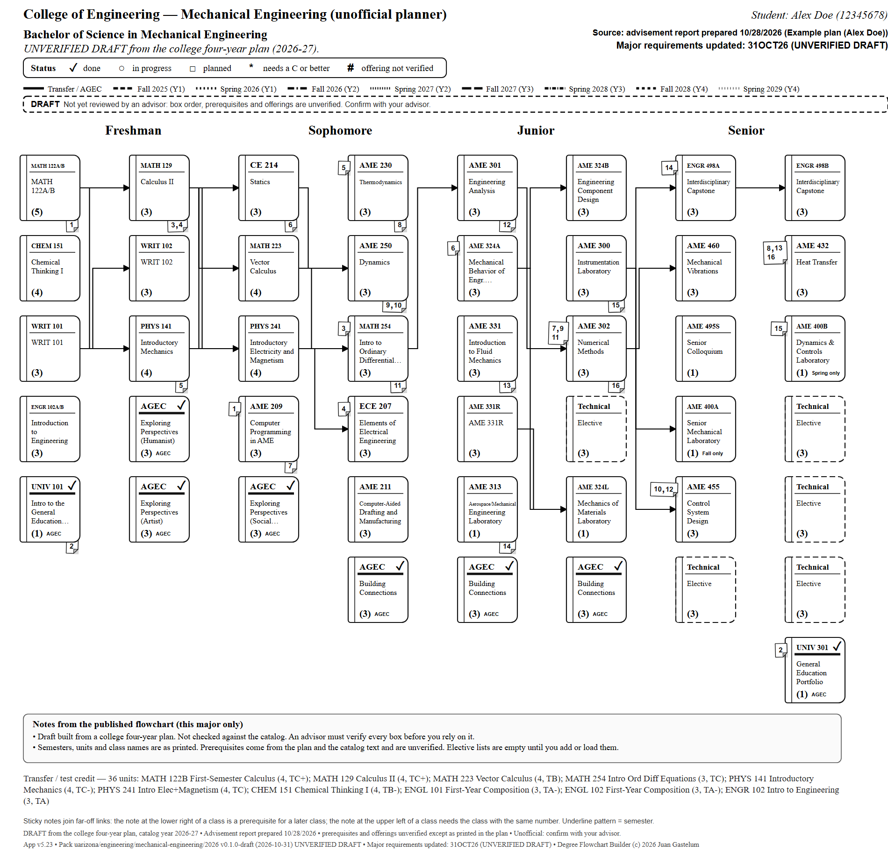</p>

- Open **Print & Export**, pick the layout and **Color** or **Black and white**, then **Save PDF** (or **Save PNG** / **Save SVG** under *Pictures*). The viewer cannot open the print dialog directly, so save a file and print that.
- The PDF is **US Letter landscape** by default, fitted to one page, with margins and a small footer. Choose **Legal** or **Tabloid (11 x 17)** under *PDF paper*.
- Letter makes the small text small (box titles about 6 pt). **Tabloid is the easiest to read.** The *My order* semester sheet is larger too.
- Black and white keeps every semester distinct by its line pattern.
- Tick **Add a "needs" line** to list each class's prerequisites under its box.
- **Save my plan** downloads your plan as a file (JSON) or as an Excel workbook; **Load file** opens either.

Every printout says it is unofficial and shows the app version, the major's version and date, and "Major requirements updated: DDMMMYY".
</details>

<details>
<summary><b>The App tab (gear)</b></summary>

<p align="center">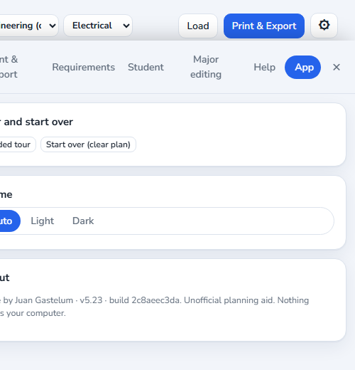</p>

- **Load file / Replace loaded file:** open a report, student file, Excel file, pack or catalog.
- **Load example plan (Alex Doe):** a made-up student to explore with.
- **Guided tour:** replay the walkthrough.
- **Start over (clear plan):** clear the plan (asks first).
- **Theme:** Auto, Light or Dark. Exports are always white.
- The bottom line shows the author, the version and the build id.
</details>

<details>
<summary><b>Guided tour and Help</b></summary>

<p align="center">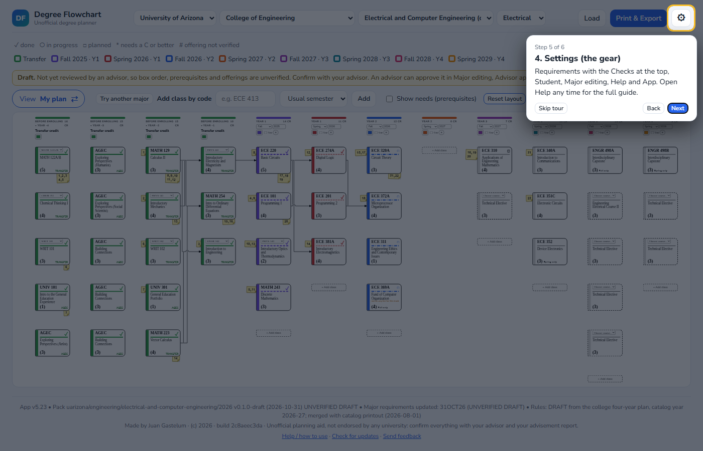 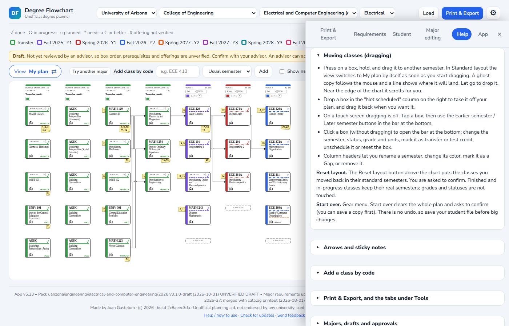</p>

The tour highlights the real buttons, step by step (Next, Back, Skip; the arrow keys work too). It starts the first time you open the app and any time from **gear, App, Guided tour**. **Help** is the same guide as collapsible sections, plus a FAQ.
</details>

<details>
<summary><b>For advisors: packs, catalogs and sharing</b></summary>

**A pack** is one major at one school, as a JSON file: an id (like `uarizona/engineering/ece/2025`), version, date, owner, tracks, boxes, requirement buckets and option lists. A student file stores only the pack id and version. Packs never overwrite each other: a different id or version is a different pack. Course data lives in one **catalog** per school.

- **Import / export:** Major editing, Advanced, *Import pack* / *Export pack*, or drag the `.json` file onto the page. Same id and version already installed: it asks before replacing. The built-in pack is never replaced.
- **Packs folder (Chrome / Edge):** Major editing, Advanced, Packs folder, *Choose packs folder*. Every pack in it loads when you open the page, and packs you save or import are written into it. After reopening, the browser may ask you to allow the folder again: press *Reconnect*. Firefox and Safari cannot connect a folder; use Export and Import there (or *Load all packs from a folder*).
- **Make a pack:** Major editing, Advanced, *Add degree* (start empty or from a copy), edit boxes, requirements, lists and the catalog in the same tab; or build a draft from a report or catalog printout.
- **Course catalogs:** Major editing, Advanced, Course catalog, Export / Import CSV or JSON. CSV columns: `code,title,units,prereqs,offered,needs_c,concurrent_ok,source,unverified`. Prereqs separated with `;`, `|` means "either" (`MATH 122B|MATH 125`). Offered: `fall`, `spring`, `springOdd`, `springEven`, `summer`, `winter`.
- **Pack library (optional):** put pack files and an `index.json` in any web folder and type its address in Major editing, Advanced, Pack library address. The page then downloads from it; nothing is uploaded. Leave it empty and the app never connects.
  ```json
  { "packs": [ { "id": "uarizona/engineering/ece/2025", "version": "1.0.0",
                 "date": "2026-10-28", "owner": "Name", "file": "ece-2025-1.0.0.json" } ] }
  ```
- **Ready-made drafts** in this repo are in [`packs/drafts/`](packs/drafts). You can import them into an older copy of the app.
</details>

<details>
<summary><b>FAQ</b></summary>

**Is my information sent anywhere?** No. The app is one file that runs on your computer. There are no accounts, tracking or servers. The only time it goes online is if you type a Pack library address in Rules and press Load; it then downloads packs from that address and uploads nothing.

**Where is my plan kept? I closed the tab.** Your plan lives only in the open page and is not saved automatically. Use *Print & Export, Save my plan* to download a file and *Load file* to open it again. Majors you import, the course catalog and your print choices are kept in this browser.

**How do I put classes back where they started?** Press **Reset layout** above the chart and confirm. To clear everything, use **Start over** (gear, App tab).

**Why does a class say "Fall only #"?** The pack lists that class as offered only that term. The `#` means the offering has not been verified. Check the schedule of classes.

**Why is a class flagged in Checks?** It sits before its prerequisite, it is in a semester where it may not be offered, or a semester is heavy. Click the line to jump to it.

**Can I change prerequisites or offerings?** Yes: Major editing, Advanced, Course catalog. Changes stay in this browser. Export the catalog or pack to share it.

**My report did not fit my major. What happened?** A temporary draft plan was built from the report, with boxes laid out by course level and a draft note. Review it in Major editing, Advanced, Build a draft pack, or pick another major.

**The PDF text is tiny.** The whole chart has to fit one page. Choose Tabloid (11 x 17) under *PDF paper*, or print the *My order* semester sheet.

**Which browsers work?** Current Chrome and Edge are best. Firefox and Safari work for planning and printing; connecting a packs folder needs Chrome or Edge.

**It says "This copy was renamed".** The file is not named exactly `JGDegreePlanner.html`. Everything still works. To remove the notice, rename the file back to exactly `JGDegreePlanner.html` (browsers add " - Copy" or " (1)" to copies: delete that part), then reopen it. In Windows: right-click, Rename. If you cannot see `.html`, turn on *File name extensions* in File Explorer (View, Show). If your office needs another name, email the author first.

**Where is the Help page?** Gear menu, *Help / how to use*, or the link at the bottom of the page.
</details>

<details>
<summary><b>Privacy and scope</b></summary>

- The whole app is one file. It runs on your computer in your browser.
- **Nothing you enter is sent to the author or to anyone else.** There are no accounts, analytics, tracking or servers.
- Your plan stays on your own machine: in this browser's local storage and in files you choose to save.
- The only way the app goes online is if you type a *Pack library address* in Rules and press Load (a plain download, nothing uploaded).
- Opening the GitHub link in the app just opens this page in your browser; the app itself does not connect.
- **Unofficial:** this is a planning aid for students and advisors. It does not replace your degree audit or your advisor, and it is not endorsed or approved by any university. Course lists, prerequisites and offerings can be wrong or out of date, especially in drafts.
</details>

<details>
<summary><b>Updates</b></summary>

Nothing updates by itself. To check for a newer version, open this page: the newest version is the **latest Release**. The version number is at the bottom of the app (for example "App v5.20"); the App tab and Help also show it. To update, replace your old file with the new one. Your saved student files are separate and keep working. The app's footer link, **Check for updates**, opens this page.
</details>

<details>
<summary><b>Contact</b></summary>

This is the only contact for the app. It is for feedback, suggestions and requests, and for advisors who want an approval code.

| What for | Click to email | Subject line |
|---|---|---|
| Feedback or a bug report | [Send feedback](mailto:jgasteluminc@gmail.com?subject=JGDegreePlanner%20feedback&body=What%20happened%2C%20or%20what%20you%20would%20like%20to%20see%3A%0A%0A%0AApp%20version%20%28shown%20at%20the%20bottom%20of%20the%20app%29%3A%0ABrowser%3A%0A%0APlease%20do%20not%20include%20student%20names%20or%20ID%20numbers.) | `JGDegreePlanner feedback` |
| A suggestion or request (for example a major to add) | [Send a suggestion](mailto:jgasteluminc@gmail.com?subject=JGDegreePlanner%20suggestion&body=My%20suggestion%20or%20request%20%28for%20example%20a%20major%20to%20add%29%3A%0A%0A) | `JGDegreePlanner suggestion` |
| Advisor approval code request | [Request a code](mailto:jgasteluminc@gmail.com?subject=JGDegreePlanner%20advisor%20code%20request&body=Name%3A%0ATitle%20%2F%20role%3A%0ACollege%20or%20department%3A%0ASchool%3A%0AHow%20you%20can%20be%20verified%20%28work%20email%20domain%20or%20staff%20directory%20page%29%3A%0APack%28s%29%20you%20would%20approve%3A) | `JGDegreePlanner advisor code request` |

Address: **jgasteluminc@gmail.com**. If the links do not open your email, write to that address and use the subject line from the table. Please do not email student names, ID numbers or plans. For a code request, include your name, title or role, college or department, school, and how you can be verified (a work email domain or staff directory page).
</details>

---

Copyright (c) 2026 Juan Gastelum. See [`LICENSE`](LICENSE): you may use the app as it is, for free. Please do not sell it, rebrand it, or remove the author notices.
